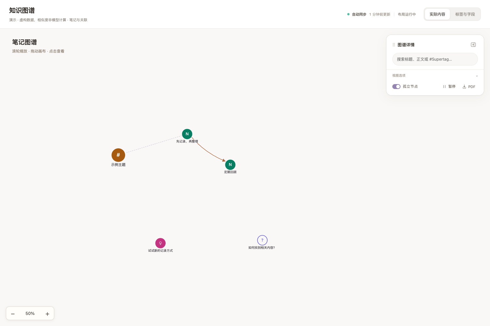

# Tana Local Graph

[](https://github.com/Init0xFFF0/tana-local-graph/actions/workflows/check.yml)

一个在本机浏览 Tana 笔记及标签结构的图谱工具。通过**只读 MCP**读取指定范围，使用本地 Qwen embedding 计算语义相似度；前端提供动态图谱、搜索、节点详情和正文链接跳转。

> 发布包只含虚构演示数据，不含作者笔记、工作区 ID、访问凭据、向量数据库或模型权重。演示相似度是手工构造的测试数据，不是 Qwen 计算结果。



## 快速体验：无需 Tana、无需模型

需要 Python **3.11 或更新版本**。在项目目录执行：

```sh
./run.sh --demo
```

打开终端打印的地址，默认 [http://127.0.0.1:8765/](http://127.0.0.1:8765/)。按 `Ctrl+C` 停止。macOS 也可以双击 `启动演示.command`；它只启动前台演示，不安装开机服务。

Windows 或希望使用安装后的命令：

```sh
python -m pip install .
tana-local-graph --demo
```

演示模式只用 Python 标准库。它不会读取任何编辑器配置、环境中的 Tana 凭据、真实工作区或本地模型。

## 功能

- 实际内容图：只显示带 Supertag 的笔记；相似度影响位置，不生成虚构引用边。
- 标签与字段图：展示范围内笔记所用标签及其关联定义，保留真实字段 ID、本地字段归属和标签继承关系。
- 按标题、正文或 `#Supertag` 搜索；支持 `#Note 关键词` 和 `#"带空格的标签"`。
- 正文链接优先在图谱内定位节点；当前范围之外的链接转到 Tana。
- 缩放输入、滚轮缩放、拖动、悬停预览、动态暂停、孤立节点过滤和打印/PDF 入口。
- 详情空态紧凑，选中后展开；标题最多两行，全文保留在预览和详情。
- 后台轮询 Tana；浏览器通过 SSE 接收变更提示，断线后重连并降级轮询。
- 最近成功数据原子保存；下一次同步失败时保留已成功的数据。

初始缩放保持 50%。画布较小时仍可能需要平移；“视图选项 → 适应窗口”会按当前节点和浮窗位置完整取景。

## 连接自己的 Tana

### 1. 准备运行环境

推荐独立虚拟环境，勿将环境目录提交仓库：

```sh
python3 -m venv .venv
. .venv/bin/activate
python -m pip install --upgrade pip
python -m pip install '.[live]'
```

Windows 可使用 `.venv\Scripts\activate` 激活。CPU 模式默认使用两个 Torch 线程。实时模式依赖较大，安装时间和内存需求取决于机器；本包没有附带运行环境或权重。

### 2. 显式下载模型

```sh
python scripts/download_model.py
```

脚本下载 `Qwen/Qwen3-Embedding-0.6B` 的固定 revision，保存到 `models/qwen3-embedding-0.6b/`。这是明确的联网步骤。运行时只从本地模型目录加载，不自动下载；下载前请自行查看模型的许可证和磁盘需求。

可以在配置中指向已有的同一 Qwen 模型目录；不支持任意不同维度的模型替换。

### 3. 配置 MCP 和读取范围

```sh
cp config.example.json config.json
```

修改 `config.json`：

- `workspace_id`：自己的真实工作区 ID。
- `root_ids`：要遍历的根节点 ID，可指定多个，例如自己的 Daily notes、Library 或 Inbox 根节点。
- `mcp_url`：你已经启用的 Tana MCP Streamable HTTP 地址。示例端口只是占位，不保证与你的服务相同。
- `exclude_ids`：额外排除的节点及其子树，默认不排除。
- `model_path`、`data_dir`：相对于配置文件所在目录解析，也接受绝对路径。
- `sync_interval`：每轮采集结束后等待的秒数，默认 5。

本项目不猜测工作区、不依赖作者的 Tana 根节点，也不会自动读取 Codex/其他编辑器的配置。需要的只读工具为 `list_workspaces`、`list_tags`、`get_children`、`read_node`、`get_tag_schema`。

若 MCP 需要 Bearer token，在当前终端设置，**不要写进示例文件、截图或 Git 提交**：

```sh
export TANA_MCP_TOKEN='在本机填入自己的 token'
```

可用 `TANA_MCP_URL` 覆盖配置地址；自定义鉴权请求头可用 `TANA_MCP_HEADERS` JSON 对象。`.env.example` 仅作说明，程序不会自动加载 `.env`。

### 4. 启动实时模式

```sh
tana-local-graph --config config.json --open
```

也可在源码目录使用 `./run.sh --config config.json`。端口可通过 `--port 8766` 调整。应用只绑定 `127.0.0.1`，请使用打印出的 `127.0.0.1` 地址访问。

MCP、模型或计算出错时，页面会保留最后成功的数据并显示连接状态；没有成功数据时显示空画布，不使用作者快照或伪造实时数据。错误阶段记录在启动终端。

## 同步方式与限制

Tana → 应用当前是**只读轮询**，不是 Tana 原生事件订阅。默认每轮完成后再等 5 秒；一次完整采集还需要工具调用、模型计算及布局时间，因此不承诺 5 秒端到端更新。浏览器 SSE 只缩短应用已得到新快照之后的传递等待。

当前为个人本地工具，尚未做数百/数千节点压力验收。成对受力和余弦矩阵有二次规模成本。标签列表达到 200、遍历超过 2,000 个容器或子列表超过保护上限时，拒绝发布可能不完整的新数据，保留最近成功数据。

目前读取 MCP 返回的标签定义及字段语法；不同版本/本地化的 Tana 输出可能需要适配。中文界面、部分英文标签和字段名（如 `Topic`、`Parent`、`Status`）属于当前实现约定。

## 项目结构

```text
src/tana_graph/
  __main__.py           # CLI
  settings.py           # 显式本机配置
  mcp_client.py         # 只读 Streamable HTTP 客户端
  collector.py          # Tana 内容和关系采集
  similarity.py         # 本地 embedding 与 SQLite 缓存
  semantic_layout.py    # 相似度初始布局
  semantic_enrichment.py
  snapshot_store.py
  server.py             # 本地 HTTP / SSE
  render.py
  web/                  # 外层、实际内容、结构图三个无个人数据模板
  examples/demo.json    # 完全虚构的示例
scripts/                # 模型下载、公开目录检查
tests/                 # 固定样例测试，不依赖作者笔记
```

## 测试

```sh
PYTHONPATH=src python3 -m unittest discover -s tests -v
python3 scripts/check_public_tree.py
```

安装后可省去 `PYTHONPATH=src`。测试会监听短暂的本机随机端口，覆盖模板注入转义、共享子内容引用、快照恢复、MCP 初始化/会话/只读限制、演示 HTTP/SSE 和访问边界，不连接真实 Tana。

GitHub Actions 会在推送和 Pull Request 时执行上述检查，结果见 [Actions](https://github.com/Init0xFFF0/tana-local-graph/actions)。本地检查范围和限制见 [发布前检查报告](docs/RELEASE_REVIEW.md)。

## 上传前

只上传这个独立目录；不要上传个人应用所在的大目录。`.gitignore` 已排除 `config.json`、`.env`、模型、缓存、日志和快照，但它不能移除已经被 Git 跟踪过的敏感文件。

当前仓库未授予额外的开源使用许可，见 [LICENSE-NOTICE.md](LICENSE-NOTICE.md)。所有者后续可选择许可证并添加正式 `LICENSE`。此项目与 Tana 官方无隶属关系。
